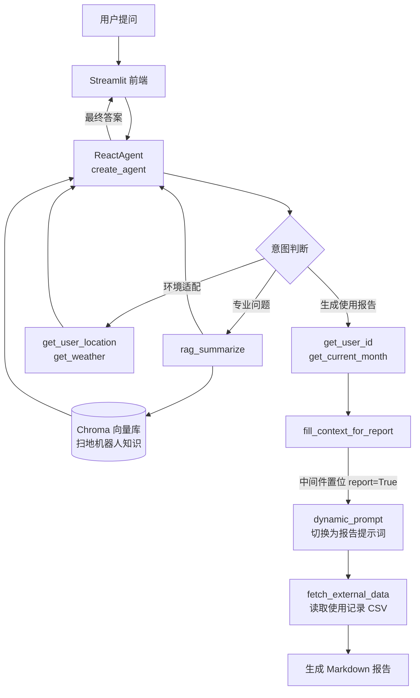

# 智扫通 · RAG + Agent 智能客服


一个面向扫地 / 扫拖一体机器人的智能客服 Agent：基于 **LangChain 1.x + LangGraph** 构建 ReAct 智能体，接入 **RAG 向量检索** 提供专业售后知识，支持多轮会话记忆与「个人使用报告」场景的提示词自动切换，前端用 Streamlit 实现流式对话。

## 核心特性

- **ReAct 自主决策**：Agent 按「思考 → 行动 → 观察 → 再思考」循环自主选择工具，单轮最多 5 次工具调用；信息不足时诚实回复"我不知道"，不编造答案。
- **Agent 中间件（Middleware）**：利用 LangChain 1.x 的 `create_agent` 中间件机制，实现工具调用监控、模型调用日志、动态提示词切换三类横切逻辑，业务代码零侵入。
- **动态提示词切换**：当识别出"生成使用报告"意图时，`fill_context_for_report` 工具在中间件里给 `runtime.context` 置位，`dynamic_prompt` 随即把系统提示词从「客服人格」切换为「报告写作人格」。
- **多会话隔离记忆**：`MemorySaver` + `thread_id` 实现按浏览器会话分区存储对话状态，同一会话内追问可继承上下文，不同会话互不干扰。
- **RAG 知识库**：Chroma 持久化向量库 + DashScope Embedding，基于文件 MD5 的增量去重加载，重复运行不会重复入库。
- **流式输出**：Agent 输出经 Streamlit `write_stream` 逐字渲染，配合 `st.rerun()` 保持对话历史。

## 技术栈

| 分类 | 选型 |
| :--- | :--- |
| 语言 | Python 3.10+（开发环境 3.13） |
| Agent 框架 | LangChain 1.4.3、LangGraph 1.2.12 |
| 大模型 | 阿里云百炼 `qwen3-max`（对话）、`text-embedding-v4`（向量化） |
| 向量库 | Chroma 1.5.9（本地持久化） |
| 文档解析 | PyPDFLoader、TextLoader、RecursiveCharacterTextSplitter |
| 前端 | Streamlit 1.65 |
| 配置 | YAML 配置驱动（`config/*.yml`） |

## 工作原理



## 项目结构

```
.
├── app.py                      # Streamlit 入口：会话管理 + 流式对话
├── agent/
│   ├── react_agent.py          # ReAct 智能体装配（工具、中间件、记忆）
│   └── tools/
│       ├── agent_tools.py      # 7 个工具定义
│       └── middleware.py       # 工具监控 / 模型日志 / 动态提示词
├── rag/
│   ├── rag_service.py          # 检索 + 总结链（Prompt | Model | Parser）
│   └── vevtor_store.py         # Chroma 向量库构建与增量加载
├── model/
│   └── factory.py              # 模型工厂：ChatTongyi / DashScopeEmbeddings
├── config/
│   ├── agent.yml               # 外部数据路径
│   ├── chroma.yml              # 向量库、分片参数、知识库路径
│   ├── rag.yml                 # 模型名称
│   └── prompts.yml             # 提示词文件路径
├── prompts/
│   ├── main_prompt.txt         # 客服人格系统提示词
│   ├── rag_summarize.txt       # RAG 总结提示词
│   └── report_prompt.txt       # 报告写作人格提示词
├── utils/
│   ├── config_handler.py       # YAML 配置加载
│   ├── file_handler.py         # PDF/TXT 加载、MD5 计算
│   ├── logger_handler.py       # 分级日志（按天滚动）
│   ├── path_tool.py            # 统一绝对路径解析
│   └── prompt_loader.py        # 提示词文件加载
├── data/                       # 知识库源文件（6 份，约 316 KB）
│   ├── 扫地机器人100问.pdf
│   ├── 扫地机器人100问2.txt
│   ├── 扫拖一体机器人100问.txt
│   ├── 故障排除.txt
│   ├── 维护保养.txt
│   └── 选购指南.txt
└── requirements.txt
```

## 快速开始

### 1. 安装依赖

```bash
python -m venv .venv
source .venv/bin/activate        # Windows: .venv\Scripts\activate
pip install -r requirements.txt
```

### 2. 配置模型凭证

项目通过阿里云百炼（DashScope）调用 Qwen 系列模型，需设置环境变量：

```bash
# Windows PowerShell
$env:DASHSCOPE_API_KEY = "sk-xxxxxxxxxxxxxxxx"

# Linux / macOS
export DASHSCOPE_API_KEY="sk-xxxxxxxxxxxxxxxx"
```

模型名称在 `config/rag.yml` 中配置：

```yaml
chat_model_name: qwen3-max
embedding_model_name: text-embedding-v4
```

> 更换模型只需改这里，无需改动代码。

### 3. 构建知识库

首次运行必须先把 `data/` 下的文档灌入向量库：

```bash
python -m rag.vevtor_store
```

脚本会遍历 `data/` 下所有 `.txt` / `.pdf` 文件，按 `chunk_size=200`、`chunk_overlap=20` 分片后写入 Chroma（`chroma_db/`），并把每个文件的 MD5 记录到 `md5.txt`。**重复执行会跳过已入库的文件**，新增文档直接再跑一次即可。

### 4. 启动应用

```bash
streamlit run app.py
```

浏览器打开终端提示的地址（默认 `http://localhost:8501`）即可对话。

也可以脱离界面直接跑命令行 Demo：

```bash
python -m agent.react_agent
```

## 工具一览

| 工具 | 入参 | 作用 |
| :--- | :--- | :--- |
| `rag_summarize` | `query` | 从向量库检索售后知识并总结 |
| `get_user_location` | — | 获取用户所在城市 |
| `get_weather` | `city` | 获取指定城市天气与环境信息 |
| `get_user_id` | — | 获取当前用户 ID |
| `get_current_month` | — | 获取当前月份（`YYYY-MM`） |
| `fetch_external_data` | `user_id`, `month` | 查询指定用户指定月份的使用记录 |
| `fill_context_for_report` | — | 触发报告场景上下文注入（前置开关） |

中间件：

| 中间件 | 钩子 | 职责 |
| :--- | :--- | :--- |
| `monitor_tool` | `wrap_tool_call` | 记录工具名与参数、捕获异常，并为报告场景置位 `context["report"]` |
| `log_before_model` | `before_model` | 记录每次模型调用前的消息条数与末条内容 |
| `report_prompt_switch` | `dynamic_prompt` | 依据 `report` 标志动态返回客服 / 报告提示词 |

## 配置说明

| 文件 | 关键项 | 说明 |
| :--- | :--- | :--- |
| `config/rag.yml` | `chat_model_name` / `embedding_model_name` | 对话与嵌入模型 |
| `config/chroma.yml` | `collection_name`、`k`、`chunk_size`、`chunk_overlap` | 向量库与检索参数，`k` 为召回条数 |
| `config/chroma.yml` | `data_path`、`allow_knowledge_file_type` | 知识库目录与允许的文件类型 |
| `config/prompts.yml` | 三个 `*_path` | 提示词文件位置，改提示词无需改代码 |
| `config/agent.yml` | `external_data_path` | 使用记录 CSV 路径 |

## 已知限制

- **部分工具为演示桩**：`get_weather`、`get_user_location`、`get_user_id`、`get_current_month` 返回固定值或随机值，用于跑通 Agent 的工具编排链路。接入真实天气 API、定位服务与业务数据库时，只需替换工具函数内部实现，`@tool` 装饰器与提示词中的能力描述无需变动。
- **使用记录为本地模拟数据**：`data/external/records.csv` 提供 10 个用户、12 个月的模拟记录，生产环境应替换为真实数据源。
- **向量库与索引文件不纳入版本控制**：`chroma_db/`、`md5.txt`、`logs/` 已在 `.gitignore` 中忽略，克隆后需按「快速开始」第 3 步重建。
- `vevtor_store.py` 文件名为项目历史拼写，导入时请保持一致。

## 致谢

项目来源于黑马程序员《AI 大模型 RAG 与智能体 Agent 项目》课程实践，在其基础上完成了代码编写与工程化整理，仅用于学习与技术交流。
